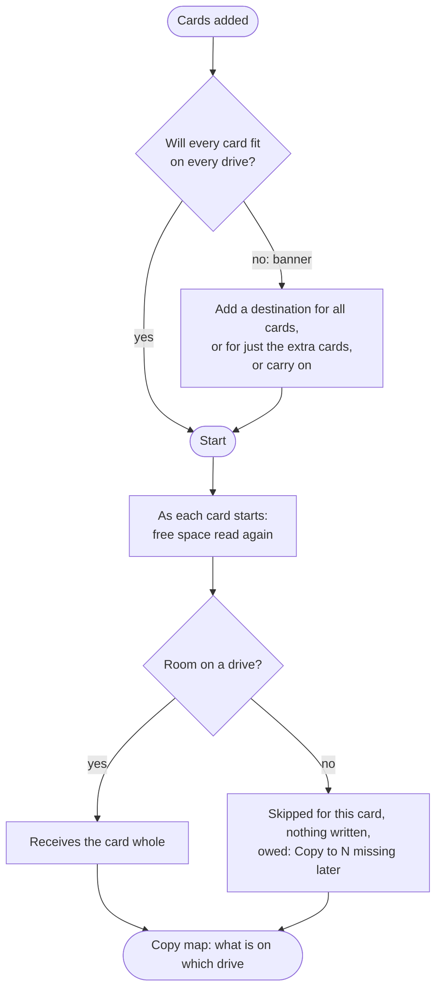

# Daily Workflow — With Enforced Naming

**For:** an operator ingesting cards at a facility whose naming convention CopyTrust applies.
**Version:** current for 3.0.4 build 75 (first written for 2.7.7)

This is the running order for a shift. It is not a reference — when you need to know *why*, the
detail is in the [CopyTrust User Guide](CopyTrust_UserGuide.md#enforced-naming-preset-activated)
and in **Help** inside the app.

If the facility uses Project Folder Creator, create the new project on the required storages
before the cards arrive: Project Folder Creator duplicates the approved template, and CopyTrust
then discovers and files cards into those prepared project folders. See the
[Project Folder Creator Quick Start](../project-folder-creator/ProjectFolderCreator_QuickStart.md).

If nobody has set the convention up yet, that is a different job: `Preset ▸ Build an Enforced
Naming Preset…`, once, with the facility present. **Stage the destinations first** — including a
proxies-only one, if the facility uses one — because the wizard captures whatever is staged when
you save it. Its last step lists exactly what it will carry.

---

## 1 · Is the preset loaded

Open CopyTrust. **Do not assume.** A convention stays in force across quits, so the app may
already be enforcing one — and it may be last week's.

Three things agree when a preset is loaded, and all three name it:

- the **Preset** button in the toolbar shows the preset's name, not the word *Preset*
- its row in the preset menu is ticked and marked **(loaded)**
- the Destinations panel says **Delivery folder set by "<name>"** in orange

If the button reads **Preset**, nothing is loaded — open the menu and **Load** the one you want.
If it shows a name with a **•**, someone changed a setting after loading it; either *Update … from
Current Settings* or load it again to discard the change.

> **A blue note instead of the orange one** — *the project list is read from these destinations* —
> means naming is on but **placement is off**. Cards will be named correctly and land wherever you
> staged them. If that is not what the facility wants: **Edit "<name>"…**, step 4, *Put the card
> inside its project folder*.

---

## 2 · Destinations — on site, or off

**On site.** The preset carries its destinations, so they stage themselves when it loads, and are
named in the confirmation before it applies. Check the panel shows what you expect and that each
has room.

**If a volume is missing,** CopyTrust says so at launch rather than at Start — *Expected volumes
are not available*, naming them, and asking *Are you off site?* Three answers:

| Button | Use it when |
|---|---|
| **Try Again** | you are about to mount the share, or just did |
| **Open SMB Connect** | the share is not mounted and you want it now — it waits up to 15 seconds per volume, and the banner names the one it is asking for |
| **Off Site** | you are not at the facility — a picker opens for the drive you actually have |

**Off site.** Take **Off Site**; a picker opens for the drive in front of you. The
convention still names the folders; it simply names them on your drive instead of theirs. Nothing
is lost — the card is filed correctly and can be re-filed on arrival. If the preset allows it, CopyTrust
also makes the project's folders on the drive from the project list it last scanned, and the
pre-copy review lists them first. The whole running order, and how the drive is brought in, is the
[CopyTrust Off-Site Workflow](CopyTrust_OffSite_Workflow.md).

CopyTrust never mounts a share itself and never holds credentials — it hands the request to SMB
Connect and reports whether the volume appeared. Mounting stays yours.

---

## 3 · Project list, then the path

Stage the card. The **naming sheet** opens as the card is added: **project**, **unit**, **roll**,
location and date, with the landing preview. **Add Source** stays disabled until the naming is valid,
and **Cancel** removes the card, so a card is never staged unnamed. Cards dropped together are named
one after another, and what the session already knows is filled in.

**Check the project list is real** before trusting the picker: *Show project list…* on the
Destinations panel lists every project found, against every destination it was found on, including
what was skipped and what could not be read. A project missing from the picker has three possible
causes and this is what tells them apart.

Then **check the path**. *Check delivery folder…* on a destination row opens a window listing every
staged card against every destination — the card, where its proxies are made, and where they are
delivered — with the volume in bold.

Read it before every job. What you want to see is:

> *project folder found · N folders to create inside it*

*project folder will be created* usually means the convention's shape does not match this storage —
worth stopping for, not worth guessing at.

If a folder is wrong, *Check delivery folder… ▸ Correct a Folder…* lets you set the right one for
that card on that destination. It is recorded as your choice.

---

## 4 · Proxies and P5, per destination

These are **per-destination checkboxes**, not global settings. Set them on the destination that
should do the work.

- **Create proxies** — tick it on the **edit** storage. Proxy generation must also be on in
  Settings › Post-Copy.
- **Send proxies to another destination…** — beneath the destination list, if proxies should also
  land somewhere that gets no originals. It is filed into that volume's own project folder, under
  the convention's *proxy* path.
- **Archive to P5** — tick it on the **archive** storage. It needs **Full** or **Inline**
  verification: those produce the hashes P5 is given. Quick and copy-only runs are deferred.

---

## 5 · Copy

Start. The pre-copy review shows the job shape and then one card per destination — path,
verification, sorting, proxy choice, P5 choice. **Check every card before continuing.**

If the cards will not all fit, a banner above the destinations says so before you start: add a
destination for all cards or for the extra ones. The review names any drive that will be skipped for
space. A drive without room is skipped for that card whole, never partly written, and the card can be
topped up later (**Copy to N missing**, or **Top up all** in the **Copy map**).

Then walk away. Turn on **Remote notifications** (Settings › Notifications) to be pushed when the run
finishes, a copy fails or a drive drops; the message holds counts only, never a name or a path. To let
someone elsewhere watch the run, send **live progress** to a CopyTrust Monitor Hub (Settings ›
Notifications › CopyTrust Monitor Hub): percent, time left and whether anyone is needed, numbers only.
With auto-advance on, a queue runs without you and nothing waits on a dialogue:
warnings that an attended copy would have shown are recorded and the run carries on.

**One thing stops it, deliberately.** A project held under two different folder names on two
destinations. CopyTrust does not choose between them: the run stops at that card, names both, and
notifies you — everything before it finished and verified.

### All cards to the same destinations

Several cards can be staged and named before Start. Leave `Copy` on **Simultaneously**: CopyTrust
copies the sources **one after another**, and each active source goes directly to every selected
destination. *Simultaneously* describes the destinations for the active card; it does not read
several cards at once. With auto-advance on, the next named card starts after the current card's
copy-and-verification gate.

### Fast destination first

When the card must be freed before a slower network destination finishes, stage **one card**, put
the fast internal flash, SSD or RAID first, put the NAS second, and set `Copy` to **In series**. The
preview reads `Card → Fast storage → NAS`. The card is copied and verified to Stop 1; Stop 2 then
reads that verified output instead of the card. CopyTrust may offer **Move to Stop 1** when its
speed or connection evidence shows that a later stop is clearly faster.

One source makes one relay chain. Queue a separate chain for each additional card taking that path.
See the [CopyTrust Workflow Guide](CopyTrust_WorkflowGuide.md#relay-chain) for the complete relay
strategy and evidence.

---

## 6 · Keep the card readers moving

A completed card stays in **Completed This Run / Completed Sources** with its verdict. When it says
**copied & verified / Ready to eject** and the required copy count is met, use **Eject** there (or
enable **Auto-eject completed source cards**). Remove the card only after macOS reports a successful
eject, insert the next card in that reader, then add it with the queue's **+ Add** button, the drop
strip under the running copy, or **Source** on its volume tile.

The enforced-naming sheet opens for the replacement card before it can start. A card added for the
same destinations joins the run and auto-advances. Proxies, reports and P5 still running for an
earlier card must not hold its copy; a card for different destinations remains a separate queued
batch. The completed card's verdict and evidence remain in the session after the physical card is
removed. **Clear Done** removes completed queue rows from the display; it is not the trust decision
that makes a card safe to eject.

---

## 7 · Before you wipe anything

- **Health clean** on every destination, `errors=0 mismatches=0`.
- The delivered folder is **where step 3 said it would be**, and named the way the facility names
  folders.
- The **Copy map** shows every card on every drive and nothing owed, or says exactly what is owed.
  A card with fewer verified copies than the minimum, or short of the preferred because of space,
  warns before it is ejected.
- A **`Receipts`** folder is inside the delivered folder on each destination, holding the log and
  the text and JSON receipts, with the MHL manifest at the top of the delivery beside it. A folder
  an older build delivered keeps its own `CopyTrust_Receipts`, and new receipts join that one
  rather than starting a second folder.
- **Full and Inline jobs have their expected MHL**; Quick intentionally has no content-hash MHL —
  that absence is not a fault at Quick.
- **Proxy and P5 status is understood separately** from the verified-original copy result; a clean
  copy can still have a proxy or P5 step that needs attention.

That JSON receipt carries the decisions — project, unit, roll, whether the roll was proposed or
typed, the preset that imposed the convention, and the exact folder each destination received.
It is the answer to a question asked in three months.

---

## If something looks wrong

| What you see | What it means |
|---|---|
| Picker empty | No destination staged yet — the project list is read from them |
| Project missing from the picker | *Show project list…* — not on the storage, unreadable, or skipped as a template |
| Card landed at the top of the drive | Placement is off — see the note in step 1 |
| Folder named right, wrong place | Same thing |
| `UnknownRoll` in a folder name | The roll was not set. Intentional and searchable — not an error |
| Two folder names for one project | CopyTrust will not choose. Answer it, or correct the folder |
| A replacement card does not start | Read the blocking reason; proxies, reports and P5 from the earlier card should not hold it |

Nothing here blocks a copy. Every gate has a way through, and *Unknown* is a listed choice on
project, unit and roll — an incomplete card is still copied, still named, and still findable.
